<!--
  SHASHWAT UPADHYAY — RESEARCH IN MOTION (Master Revision V3.0)
  Compact Editorial AI Research Portfolio & Automated Design System
  Ground Truth: Shashwat_Research_Resume_2026-10-28.pdf
-->

<!-- 01 · COMPACT HERO CARD -->

  

<!-- 02 · 5 CORE RESEARCH DIRECTIONS -->
<picture>
  <source media="(prefers-color-scheme: dark)" srcset="./cards/title-research-dark.svg" />
  
</picture>

  

<!-- 03 · FEATURED RESEARCH PROJECTS (ROW OF 3) -->
<picture>
  <source media="(prefers-color-scheme: dark)" srcset="./cards/title-projects-dark.svg" />
  
</picture>

  <a href="https://github.com/shashwatology?tab=repositories">Explore all 45 public repositories &#8599;</a>

<!-- 04 · PUBLICATIONS & SCHOLARLY MILESTONES -->
<picture>
  <source media="(prefers-color-scheme: dark)" srcset="./cards/title-publications-dark.svg" />
  
</picture>

| Manuscript / Publication Title | Venue / Publisher | Year | Status | Verified Link |
| :-- | :-- | :-: | :-: | :-: |
| **Semantic Drift Before Inference: A Preprocessing Attack Surface in Vision–Language Models** S.A.K. Upadhyay, S.B. Sharma, R.A. Borgalli, R. Vairagade | *Adaptive Defense and Intelligent Security Architectures for AI-Driven Cybersecurity (IGI Global)*, Ch. 6, pp. 171–202 | 2026 | `Accepted / DOI Assigned` | [**DOI: 10.4018/979-8-2600-5116-0.ch006**](https://doi.org/10.4018/979-8-2600-5116-0.ch006) · [Code](https://github.com/Shashwatology/semantic-drift-vlm-attacks) |
| **Fake news detection using deep learning models: A novel approach** Sachin Kumar, Rohan Asthana, Shashwat Upadhyay, N. Upreti, M. Akbar | *Transactions on Emerging Telecommunications Technologies (Wiley)* | 2020 | `Published` | [**DOI: 10.1002/ett.3767**](https://doi.org/10.1002/ett.3767) |
| **Protocol-Driven Framework for Implementing an Integrated Multimodal Transportation System in Jaipur, India** S.A.K. Upadhyay (mentor: Prof. Nand Kumar) | *Proceedings of the 18th International Asian Urbanization Conference (IAUC 2026)*, p. 122 | 2026 | `Published` | [**IAUC Proceedings**](https://github.com/Shashwatology) |
| **An IoMT-Based Wearable Prototype for Sustainable Remote Patient Monitoring** S.A.K. Upadhyay, A.K. Singh, A.A. Tiwari, R. Borgalli | *National Conference on Data-Centric AI (DASDA 2025)* | 2025 | `Best Paper Award` | [**ResearchGate**](https://www.researchgate.net/publication/397178065_An_IoMT-Based_Wearable_Prototype_Sustainable_Remote_Patient_Monitoring) |
| **Technology Intervention for an Efficient Judicial System** Y. Jain, S.A.K. Upadhyay | *Conference Proceedings (ResearchGate Verified)* | 2025 | `Published` | [**ResearchGate**](https://www.researchgate.net/publication/394205684_Technology_Intervention_for_an_Efficient_Judicial_System) |
| **SentinelAI: Adaptive Behavioral Risk Framework for Real-Time SSH Threat Detection** S.A.K. Upadhyay | *Cybersecurity Systems Venue* | 2026 | `Under Review` | [**SentinelAI Code**](https://github.com/shashwatology/SentinelAI) |
| **PhysioFM: A Diagnostic Framework for Transformer-Based Remote Photoplethysmography** S.A.K. Upadhyay, S.B. Sharma, N. Kumar, S. Kumar, Bhoomika | *Int’l Conf. on Next-Gen Structural Health Monitoring Systems (SHMS-2026)*, Paper ID 123 | 2026 | `Presented (Oct 2026)` | [**PhysioFM Code**](https://github.com/Shashwatology/PhysioFM) |

 

<!-- 05 · ACADEMIC & RESEARCH MILESTONES -->

  

 

<!-- 06 · TECHNOLOGY TOOLKIT -->

<picture>
  <source media="(prefers-color-scheme: dark)" srcset="./cards/title-stack-dark.svg" />
  
</picture>

| Domain | Core Tools &amp; Frameworks |
| :-- | :-- |
| **Programming &amp; Core** | `Python 3.10+` · `C++ 17/20` · `TypeScript` · `JavaScript` · `SQL` · `Bash` |
| **AI &amp; Machine Learning** | `PyTorch` · `Hugging Face Transformers` · `Swin-V2` · `TimeSformer` · `Scikit-learn` · `TorchVision` |
| **Computer Vision &amp; OCR** | `OpenCV` · `YOLO (v8/v9)` · `CLIP Embeddings` · `Waveform Extraction (rPPG)` · `Spectral Analysis` · `Tesseract OCR` |
| **Cyber &amp; ML Security** | `VLM Preprocessing Auditing (SEV)` · `Isolation Forests (Zero-Label)` · `SSH Threat Modeling` · `CICIDS2017 Benchmark` |
| **Infrastructure &amp; Systems** | `SUMO Traffic Simulation` · `Unity 3D Engine` · `GIS Integration` · `Docker` · `Git &amp; GitHub Actions CI/CD` · `LaTeX` |

 

<!-- 07 · GITHUB TELEMETRY & BLUE HEATMAP -->
<picture>
  <source media="(prefers-color-scheme: dark)" srcset="./cards/title-activity-dark.svg" />
  
</picture>

  

  

<!-- 08 · FEATURED REPOSITORIES -->
<picture>
  <source media="(prefers-color-scheme: dark)" srcset="./cards/title-repos-dark.svg" />
  
</picture>

| Repository | Primary Focus | Language | Architecture / Stack |
| :-- | :-- | :-: | :-- |
| [**PhysioFM**](https://github.com/Shashwatology/PhysioFM) | Non-contact rPPG foundation model &amp; optimization diagnostics | `Python` | Swin-V2 · STDS · UBFC-rPPG · PyTorch |
| [**Guardian-Travel-Twin**](https://github.com/Shashwatology/Guardian-Travel-Twin-) | 25 km multimodal corridor digital twin &amp; microscopic simulation | `C# / Python` | SUMO · Unity 3D · YOLOv8 · MoHUA IMPACT |
| [**semantic-drift-vlm-attacks**](https://github.com/Shashwatology/semantic-drift-vlm-attacks) | Preprocessing attack surfaces &amp; SEV defense in VLMs | `Python` | IGI Global 2026 Chapter · RGBA-to-RGB Auditing |
| [**SentinelAI**](https://github.com/shashwatology/SentinelAI) | Zero-label behavioral anomaly detection engine for SSH streams | `Python` | Isolation Forest · CICIDS2017 · Real-Time Engine |
| [**Semantic-Ctrl-F**](https://github.com/Shashwatology/Semantic-Ctrl-F) | Visual-semantic document retrieval &amp; contrastive indexing | `TypeScript` | CLIP · Vector Indexing · Cross-Modal Retrieval |

 

<!-- 09 · CONNECT & COLLABORATE FOOTER -->
<picture>
  <source media="(prefers-color-scheme: dark)" srcset="./cards/title-connect-dark.svg" />
  
</picture>

  <a href="https://github.com/shashwatology"><b>GitHub</b></a> &nbsp;·&nbsp;
  <a href="https://scholar.google.com/citations?user=ulC0-soAAAAJ"><b>Google Scholar</b></a> &nbsp;·&nbsp;
  <a href="https://in.linkedin.com/in/shashwatupadhyay"><b>LinkedIn</b></a> &nbsp;·&nbsp;
  <a href="https://www.researchgate.net/profile/Shashwat-Upadhyay-2"><b>ResearchGate</b></a> &nbsp;·&nbsp;
  <a href="mailto:shashwatology.s@gmail.com"><b>Email</b></a> &nbsp;·&nbsp;
  <a href="https://bento.me/shashwatupadhyay"><b>Bento</b></a>

  RESEARCHING INTELLIGENCE. BUILDING SYSTEMS. &copy; 2026 SHASHWAT UPADHYAY.

