<!--
  SHASHWAT UPADHYAY — RESEARCH IN MOTION (Version 2.0)
  Compact Editorial AI Research Portfolio & Automated Design System
-->

<!-- 01 · COMPACT HERO CARD -->

  

<!-- 02 · RESEARCH DIRECTIONS -->
<picture>
  <source media="(prefers-color-scheme: dark)" srcset="./cards/title-research-dark.svg" />
  
</picture>

  

<!-- 03 · FEATURED RESEARCH PROJECTS (ROW OF 3) -->
<picture>
  <source media="(prefers-color-scheme: dark)" srcset="./cards/title-projects-dark.svg" />
  
</picture>

  <a href="https://github.com/shashwatology?tab=repositories">Explore all public repositories &#8599;</a>

<!-- 04 · PUBLICATIONS & MILESTONES -->
<picture>
  <source media="(prefers-color-scheme: dark)" srcset="./cards/title-publications-dark.svg" />
  
</picture>

| Manuscript / Publication Title | Venue / Framework | Year | Status | Verified Link |
| :-- | :-- | :-: | :-: | :-: |
| **Fake news detection using deep learning models: A novel approach** Sachin Kumar, Rohan Asthana, Shashwat Upadhyay, N. Upreti, M. Akbar | *Transactions on Emerging Telecommunications Technologies (Wiley)* | 2020 | `Published` | [**DOI: 10.1002/ett.3767**](https://doi.org/10.1002/ett.3767) |
| **Semantic Drift Before Inference: A Preprocessing Attack Surface in Vision–Language Models** Shashwat Upadhyay | *Research Working Paper &amp; Reproducible Testbed* | 2026 | `In Progress` | [**Codebase &amp; Paper**](https://github.com/Shashwatology/semantic-drift-vlm-attacks) |
| **PhysioFM: Optimization Diagnostics and Failure Analysis of Hierarchical Foundation Models in rPPG** Shashwat Anil Kumar Upadhyay | *Master Research Dossier &amp; PyTorch Framework* | 2026 | `In Progress` | [**Research Dossier**](https://github.com/Shashwatology/PhysioFM) |

 

  

 

<!-- 05 · TECHNOLOGY TOOLKIT -->

<picture>
  <source media="(prefers-color-scheme: dark)" srcset="./cards/title-stack-dark.svg" />
  
</picture>

| Domain | Core Tools &amp; Frameworks |
| :-- | :-- |
| **Programming** | `Python 3.10+` · `C++ 17/20` · `TypeScript` · `JavaScript` · `SQL` |
| **AI &amp; Machine Learning** | `PyTorch` · `Hugging Face Transformers` · `Swin-V2` · `TimeSformer` · `Scikit-learn` |
| **Computer Vision** | `OpenCV` · `YOLO (v8/v9)` · `CLIP` · `Waveform Extraction (BVP)` · `Spectral Analysis` |
| **Cyber &amp; ML Security** | `VLM Preprocessing Auditing` · `Isolation Forests (Zero-Label)` · `Threat Modeling` · `OSINT` |
| **Research &amp; Engineering** | `LaTeX` · `Docker` · `SUMO Simulation` · `Unity 3D Engine` · `Git &amp; CI/CD Actions` |

 

<!-- 06 · GITHUB TELEMETRY & BLUE HEATMAP -->
<picture>
  <source media="(prefers-color-scheme: dark)" srcset="./cards/title-activity-dark.svg" />
  
</picture>

  

<!-- 07 · MINIMAL CONNECT FOOTER -->

  <a href="https://github.com/shashwatology"><b>GitHub</b></a> &nbsp;·&nbsp;
  <a href="https://www.linkedin.com/in/shashwat-upadhyay-13abb020b/"><b>LinkedIn</b></a> &nbsp;·&nbsp;
  <a href="https://www.researchgate.net/profile/Shashwat-Upadhyay-2"><b>ResearchGate</b></a> &nbsp;·&nbsp;
  <a href="mailto:shashwatology.s@gmail.com"><b>Email</b></a> &nbsp;·&nbsp;
  <a href="https://bento.me/shashwatupadhyay"><b>Bento</b></a>

  RESEARCHING INTELLIGENCE. BUILDING SYSTEMS. &copy; 2026 SHASHWAT UPADHYAY.

